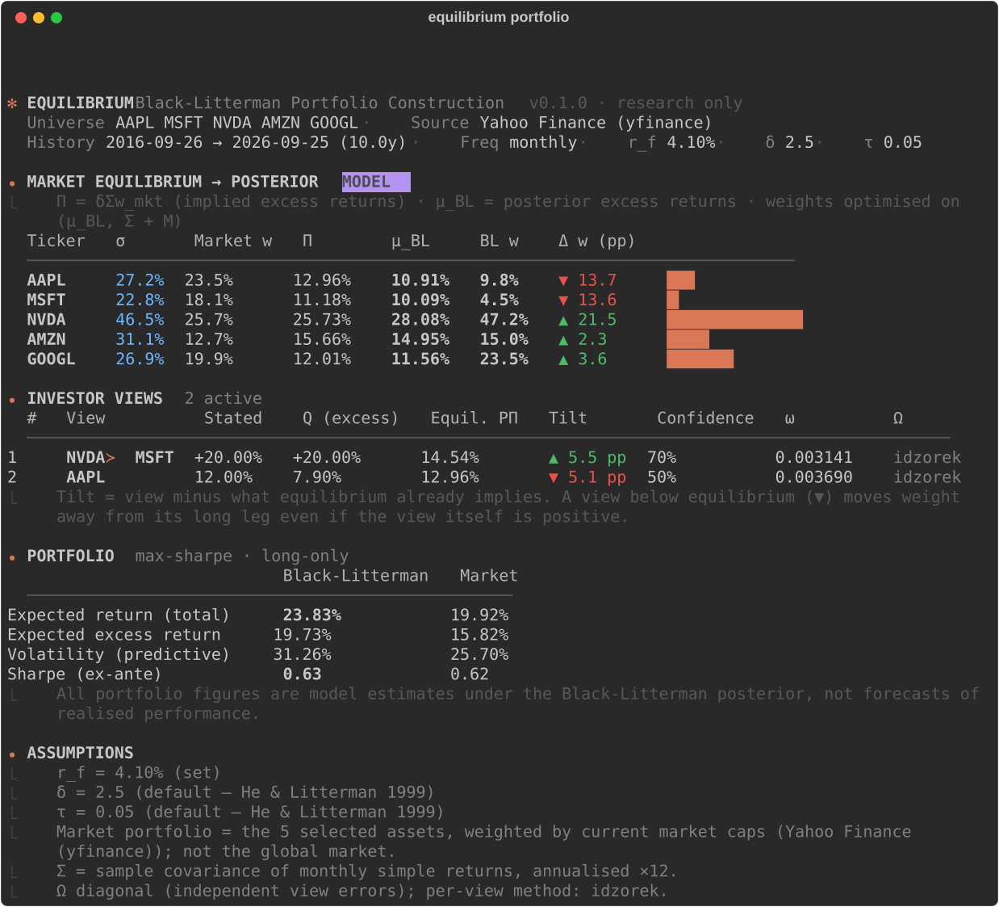
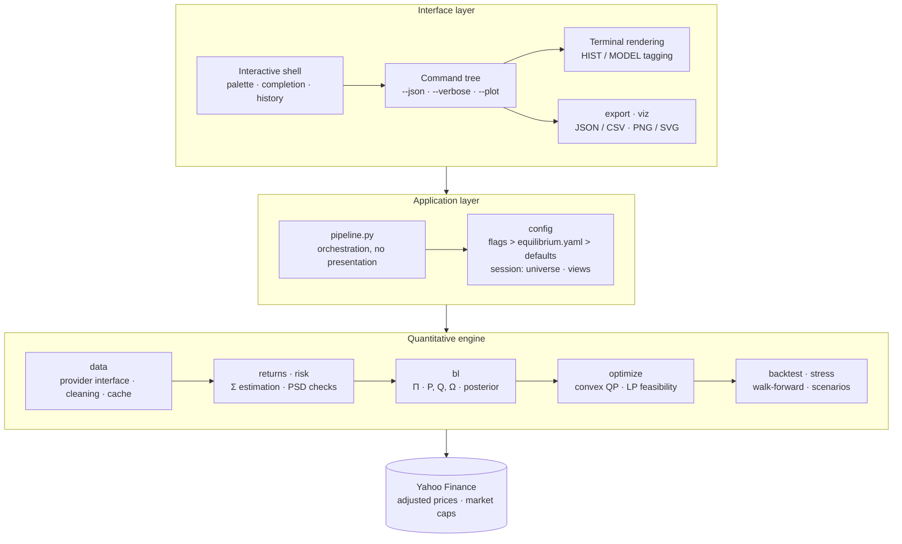
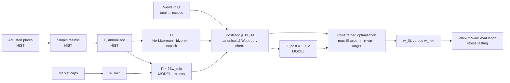
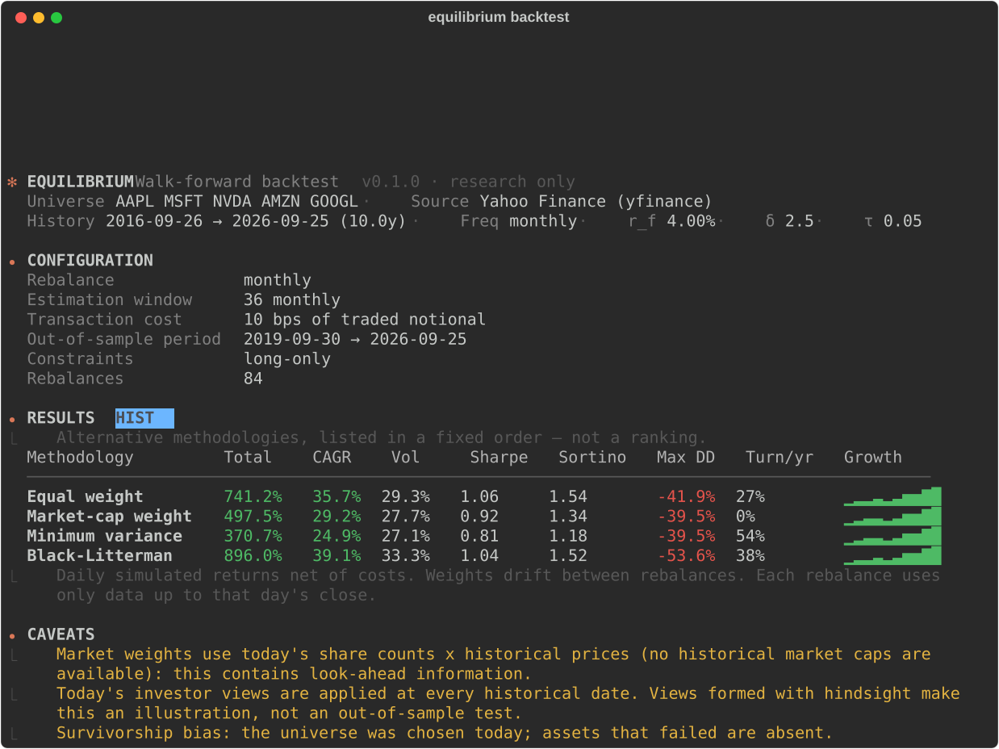

<div align="center">

# ✻ Equilibrium

**A reproducible research instrument for Bayesian portfolio construction under the Black-Litterman framework.**

[](https://www.python.org)
[](#evaluation)
[](#engineering-verification)
[](#usage)
[](LICENSE)

</div>



## Abstract

Mean-variance optimisation (Markowitz, 1952) is the canonical model of portfolio choice, yet
in practice it behaves as an estimation-error maximiser: small perturbations in expected-return
inputs produce extreme, unstable and economically implausible allocations (Michaud, 1989).
The Black-Litterman model (Black & Litterman, 1990, 1992) addresses this by anchoring expected
returns to the equilibrium implied by market capitalisations, then updating that prior with
investor views in proportion to their stated precision. Although the model is widely taught,
public implementations frequently conflate excess and total returns, confuse the covariance of
returns with the uncertainty of the mean, leave the mapping from confidence to view variance
unspecified, and evaluate the resulting portfolios with backtests contaminated by look-ahead.

**Equilibrium** is a command-line research instrument that implements the full pipeline —
reverse optimisation of CAPM equilibrium, posterior inference, constrained optimisation,
walk-forward evaluation and stress testing — with each of these failure modes treated as a
first-class design constraint. Returns are typed by economic kind (excess or total) and
epistemic status (historical observation or model estimate); the posterior is computed in two
algebraically equivalent forms that are cross-validated at runtime; view uncertainty is derived
from an explicit, documented calibration; and every simulated rebalance is restricted to the
information set available at its date. Correctness is established against a hand-derived
analytical example, closed-form limiting cases and independent re-implementations, rather than
asserted.

## Contents

- [Motivation](#motivation)
- [Design principles](#design-principles)
- [Contributions](#contributions)
- [Methodology](#methodology)
- [Architecture](#architecture)
- [Key technical decisions](#key-technical-decisions)
- [Evaluation](#evaluation)
- [Usage](#usage)
- [Limitations and future work](#limitations-and-future-work)
- [Author](#author)
- [References](#references)
- [License and disclaimer](#license-and-disclaimer)

## Motivation

The Black-Litterman model is conceptually simple and numerically delicate. Its outputs depend
on several quantities that are routinely misspecified:

- **Excess versus total returns.** Implied equilibrium returns `Π = δΣw_mkt` are excess
  returns, whereas investors state absolute views as total returns. Mixing the two, or
  subtracting the risk-free rate a second time inside a Sharpe-ratio objective, silently biases
  every downstream allocation.
- **Three distinct covariance objects.** The covariance of returns `Σ`, the posterior
  uncertainty of the mean `M`, and the posterior predictive covariance `Σ + M` answer different
  questions and are frequently conflated.
- **Confidence has no canonical meaning.** The original papers do not define a mapping from a
  verbal confidence level to the view-error variance `Ω`; an implementation that accepts a
  "70% confidence" without stating how it enters `Ω` is not reproducible.
- **Views are relative to equilibrium, not to zero.** A view moves the posterior only through
  `Q − PΠ`. The view "asset A outperforms asset B by 5%" is *bearish* on A whenever equilibrium
  already implies a wider spread — a correct but counter-intuitive property that is easily
  misread without instrumentation.
- **Evaluation leaks information.** Historical market capitalisations are rarely available,
  and views formulated today are routinely applied to past dates, introducing look-ahead into
  backtests that are then presented as out-of-sample.

Equilibrium is an attempt to make each of these choices explicit, inspectable and tested.

## Design principles

1. **Equilibrium first.** The prior is the market-implied return vector, not a sample mean;
   historical means are available only as a clearly labelled comparison.
2. **Types carry economic meaning.** Every return vector declares whether it is an excess or a
   total return and whether it is an observation or an estimate. The optimiser rejects total
   returns; the posterior rejects a total-return prior.
3. **Every assumption is stated.** Defaults for `r_f`, `δ`, `τ`, the market definition and the
   `Ω` calibration are printed alongside every result, together with whether each was set by
   the user or assumed.
4. **Fail loudly, never substitute.** Unknown tickers, insufficient history, non-positive-
   semidefinite covariances, infeasible constraints and contradictory certain views raise
   explicit errors. No security, price or proxy is ever silently substituted.
5. **Numerical honesty.** Linear systems are solved by Cholesky factorisation rather than
   explicit inversion; conditioning is reported; covariance repair is opt-in and quantified.
6. **Separation of concerns.** The quantitative engine has no dependency on the presentation
   layer; the command line, the JSON exporter and the test suite consume the same typed results.

## Contributions

- A complete, typed implementation of the Black-Litterman pipeline in which the excess/total
  and observation/estimate distinctions are enforced by construction.
- A **closed-form statement of Idzorek's (2005) confidence calibration**. For a single view,
  the unconstrained tilt toward the view is exactly `pτΣp' / (pτΣp' + ω)` of the
  full-confidence tilt, which yields `ω = ((1 − C)/C)·pτΣp'`. This reproduces Idzorek's
  numerical least-squares procedure exactly, is verified numerically in the test suite, and
  shows that `C = 0.5` coincides with the He-Litterman (1999) proportional specification.
- Runtime cross-validation of the canonical precision-weighted posterior against its
  Woodbury-identity form, with the discrepancy reported as a diagnostic (typically ~10⁻¹⁶).
- Instrumentation of the **view-relative-to-equilibrium** effect: each view is reported with
  its equilibrium-implied value `PΠ` and the resulting tilt `Q − PΠ`.
- A walk-forward evaluation harness with drifting weights, transaction costs on traded
  notional, and explicit disclosure of every residual source of look-ahead or selection bias.

## Methodology

Full derivations, conventions and references are given in
[`docs/methodology.md`](docs/methodology.md).

**Prior.** Under the representative-investor argument of the CAPM (Sharpe, 1964; Lintner,
1965), the market portfolio is mean-variance optimal, and reverse optimisation yields implied
excess returns `Π = δΣw_mkt`. The prior on the mean is `μ ~ N(Π, τΣ)`.

**Views.** `Pμ = Q + ε`, `ε ~ N(0, Ω)`, with absolute views converted from total to excess
returns and relative views expressed as spreads.

**Posterior.**

```
μ_BL   = [(τΣ)⁻¹ + P'Ω⁻¹P]⁻¹ [(τΣ)⁻¹Π + P'Ω⁻¹Q]  =  Π + τΣP'(PτΣP' + Ω)⁻¹(Q − PΠ)
M      = [(τΣ)⁻¹ + P'Ω⁻¹P]⁻¹                         uncertainty of the mean estimate
Σ_post = Σ + M                                       posterior predictive covariance
```

The Woodbury form requires only a `K × K` solve and remains defined for a singular `Ω`
(views held with certainty).

**View uncertainty.** `Ω` is diagonal and specified per view by one of three documented rules:
He-Litterman proportionality `ω = pτΣp'`; Idzorek confidence `ω = ((1 − C)/C)·pτΣp'`; or an
explicit variance.

**Risk estimation.** Unbiased sample covariance or Ledoit-Wolf (2004) shrinkage toward a
scaled identity; symmetry and positive-semidefiniteness checks; optional Frobenius-nearest PSD
repair by eigenvalue clipping (Higham, 1988); condition-number diagnostics.

**Optimisation.** Minimum variance, target return, maximum utility and maximum Sharpe ratio
under budget and box constraints. The non-convex Sharpe objective is solved through its convex
homogenised reformulation (Cornuéjols & Tütüncü, 2007); feasibility is established by linear
programming before any quadratic programme is attempted.

**Evaluation.** Walk-forward rebalancing in which each decision uses only closes up to its
date; weights drift between rebalances; costs are proportional to traded notional. Historical
stress scenarios use observed buy-and-hold returns; hypothetical shocks propagate through the
conditional Gaussian mean `E[r_U | r_K = s] = Σ_UK Σ_KK⁻¹ s`.

## Architecture

The system is organised in three layers with a strict dependency rule: arrows denote calls,
dependencies point only downward, and the quantitative engine imports nothing from the
application or interface layers (no terminal, rendering or command-line library). Every result the interface displays
is a typed object produced by the engine, so the terminal view, the JSON output, the exports
and the test suite observe identical numbers.



### Inference pipeline

The central object is not a single number but a chain of typed quantities. Each is labelled
by provenance: `HIST` for observations, `MODEL` for estimates. The excess/total conversion is
made exactly once, where views enter.



| Layer | Package | Responsibility |
|---|---|---|
| Engine | `core/` | Typed vectors carrying ticker alignment, excess/total kind and historical/model provenance; the exception hierarchy. |
| Engine | `data/` | The `MarketDataProvider` interface, the Yahoo Finance adapter, a seeded synthetic provider, cleaning (calendars, gaps, duplicates, timezones) and an on-disk cache. |
| Engine | `returns/`, `risk/` | Return construction and annualisation; sample and Ledoit-Wolf covariance; PSD validation and repair; ex-ante and ex-post risk metrics. |
| Engine | `bl/` | Reverse optimisation, view matrices, Ω calibration and posterior inference. Pure functions, unit-tested against analytical results. |
| Engine | `optimize/` | Constraint validation, LP feasibility, quadratic programmes and the efficient frontier. |
| Engine | `backtest/`, `stress/` | Walk-forward simulation with drifting weights and costs; historical and hypothetical stress tests. |
| Application | `pipeline.py`, `config/` | Orchestration of the engine; settings precedence and inspectable session state. |
| Interface | `cli/`, `export/`, `viz/` | Command tree, interactive shell, terminal rendering, JSON/CSV bundles and charts. No business rules beyond presentation. |

<details>
<summary>Source tree</summary>

```
src/equilibrium/
  core/        typed vectors (excess/total × historical/model), exception hierarchy
  data/        MarketDataProvider interface, Yahoo Finance adapter, synthetic provider,
               cleaning (calendars, gaps, duplicates, timezones), on-disk cache
  returns/     simple and log returns, period-end resampling, annualisation
  risk/        covariance estimators, numerical safety, ex-ante and ex-post risk metrics
  bl/          equilibrium, views, Ω calibration, posterior inference
  optimize/    constraints and feasibility, optimisers, efficient frontier
  backtest/    walk-forward engine, allocation methodologies
  stress/      historical scenarios and hypothetical shocks
  export/      JSON and CSV research bundles with embedded provenance
  viz/         publication-quality charts (colour-vision-deficiency-safe palette)
  config/      YAML settings with precedence rules; inspectable session state
  pipeline.py  orchestration, free of presentation code
  cli/         command tree, terminal rendering, interactive shell
```

</details>

The data provider is an abstract interface, so the Yahoo Finance adapter can be replaced by a
licensed vendor feed without modifying the quantitative engine.

## Key technical decisions

| Decision | Rationale |
|---|---|
| Simple rather than log returns for portfolio work | Simple returns aggregate exactly across assets (`R_p = w'R`); log returns do not. |
| Period-end price sampling for lower frequencies | Avoids compounding or summing daily simple returns; observation dates are preserved, so no timestamp points past its information. |
| Woodbury posterior as the primary form | A `K × K` rather than `N × N` solve; defined for 100%-confidence views; cross-checked against the canonical form. |
| Posterior predictive covariance `Σ + M` for optimisation | Accounts for estimation risk in the mean (He & Litterman, 1999); with no views, the max-Sharpe portfolio recovers `w_mkt` exactly. |
| Convex reformulation of max-Sharpe | The direct objective is non-convex; the homogenised quadratic programme has a unique global optimum. |
| Views outside the universe are set aside, not discarded | Saved views persist across universes; inactive views are reported rather than silently ignored. |
| Current market caps, with a disclosed approximation in backtests | Free sources provide no historical capitalisations; the resulting look-ahead is stated on every run rather than hidden. |

## Evaluation

Correctness is assessed by derivation and independent re-computation rather than by
backtested performance, which carries no information about whether the model is implemented
correctly.

### Analytical verification

| Property | Test |
|---|---|
| Posterior mean and uncertainty | A three-asset example derived by hand (volatilities 20/30/15%, pairwise correlation 0.2, `w_mkt = (0.5, 0.3, 0.2)`, `δ = 2.5`, `τ = 0.05`, one absolute view with `ω = 0.0005`), with expected values written as exact fractions, e.g. `μ_C = (4/13)·0.0255 + (9/13)·0.05`. Matched to 10⁻¹⁴. |
| Formulation equivalence | Canonical and Woodbury forms agree to 10⁻¹³ with multiple views; `M` agrees with the explicit precision inverse. |
| No-view limit | `μ_BL = Π` exactly; `M = τΣ`; `Σ_post = (1 + τ)Σ`; unconstrained optimum `w_mkt/(1 + τ)`; fully invested max-Sharpe portfolio equal to `w_mkt`. |
| Confidence limits | The posterior shift vanishes as `C → 0`, is monotone in `C`, and satisfies `Pμ_BL = Q` exactly at `C = 1`. |
| Idzorek calibration | For `C ∈ {0.1, 0.3, 0.7, 0.95}`, the realised tilt equals `C` times the full-confidence tilt to 10⁻¹². |
| τ-invariance | Under He-Litterman `Ω`, the posterior mean is invariant to `τ`. |
| Optimisers | Numerical solutions match the closed-form minimum-variance and tangency portfolios; the constrained max-Sharpe solution is not improved upon by 2,000 random feasible portfolios. |
| Covariance | The sample estimator matches a hand-computed example; Ledoit-Wolf matches an independent vectorised derivation of the published formulas. |
| Look-ahead | Rewriting future prices leaves all past weights unchanged; strategies never receive observations after the rebalance date; the equal-weight simulation is reproduced by an independent implementation. |

### Engineering verification

- **129** offline tests on synthetic and hand-computed data, and **3** live integration tests
  against Yahoo Finance (`pytest -m live`).
- Static typing with `mypy` and linting with `ruff`, both clean.
- Adversarial inputs — shell metacharacters in tickers, `!!python/object` YAML payloads,
  ambiguous percentages, contradictory certain views — are rejected under test.

## Usage

### Installation

```sh
curl -LsSf https://raw.githubusercontent.com/eddylam2024/equilibrium/main/install.sh | sh
```

The installer provisions [uv](https://docs.astral.sh/uv/) if absent and installs Equilibrium
as an isolated tool on Python ≥ 3.12, exposing `equilibrium` and the alias `eq`.
Alternatively, run `uv tool install git+https://github.com/eddylam2024/equilibrium`, or
`make install` from a clone.

### Workflow

```sh
equilibrium                                            # interactive research shell
eq portfolio AAPL MSFT NVDA AMZN GOOGL --period 10y    # equilibrium → posterior → portfolio
eq views add --long NVDA --short MSFT --spread 5% --confidence 70%
eq portfolio --verbose                                 # P, Q, Ω, M and numerical diagnostics
eq frontier --plot                                     # efficient frontier with marked portfolios
eq backtest --rebalance monthly --cost 10 --plot       # walk-forward comparison
eq stress --scenario gfc --shock NVDA=-30%             # historical and hypothetical stress
eq export --format csv --out research/                 # research bundle with provenance
```

Every command supports `--json` for machine-readable output and `--synthetic` for an offline,
seeded and explicitly labelled synthetic market. All quantities on screen are tagged `HIST`
(historical observation) or `MODEL` (model estimate).

| Command | Purpose |
|---|---|
| `data` | Acquire, clean and summarise adjusted prices |
| `analyze` | Per-asset historical statistics and correlation structure |
| `covariance` | Annualised Σ and correlation with numerical diagnostics |
| `risk` | Ex-ante variance, marginal and component risk contributions |
| `views` | Specify absolute and relative views; inspect `P`, `Q` and `Ω` |
| `portfolio` | Equilibrium, posterior and optimised allocation versus the market portfolio |
| `optimize` | Minimum variance, maximum Sharpe, target return, maximum utility |
| `frontier` | Efficient frontier under posterior, equilibrium or historical inputs |
| `backtest` | Walk-forward evaluation of alternative methodologies |
| `stress` | Historical scenarios and hypothetical shocks |
| `export` | JSON or CSV bundle of all inputs, estimates and results |
| `config` | Effective settings and their provenance; `equilibrium.yaml` template |



### Configuration

Settings resolve with the precedence **command-line flags > `equilibrium.yaml` > documented
defaults**. `equilibrium config init` writes an annotated template; `equilibrium config show`
reports each value and its origin.

## Limitations and future work

**Limitations.**

- *Market definition.* The market portfolio is the selected universe weighted by current
  capitalisation, not the global market portfolio of the CAPM.
- *Historical capitalisations.* Backtested capitalisation weights are approximated by current
  share counts times historical prices, which embeds future information on issuance and
  buybacks.
- *View timing.* Views applied at historical dates were formed with hindsight; such backtests
  are illustrative, not out-of-sample.
- *Survivorship.* Universes are chosen ex post.
- *Distributional assumptions.* The posterior and the conditional-shock stress test are
  Gaussian; realised crises exhibit fat tails and correlation breakdown.
- *Frictions.* Transaction costs are linear; taxes, borrowing costs and market impact are not
  modelled. A single currency is assumed.
- *Data.* Yahoo Finance data is unofficial and unaudited.

**Future work.** Factor-model priors and attribution using the Fama-French data library;
full (non-diagonal) `Ω` from the command line; a market-implied risk-aversion option;
entropy-pooling views (Meucci, 2008); robust and resampled optimisation; and point-in-time
constituent and capitalisation data for survivorship-free evaluation.

## Author

**Edouard Lam** designed and built Equilibrium. It sits where banking and quantitative
software meet: front-line experience with clients and regulated products at two of Canada's
Big Five banks, combined with building rigorous, verifiable tools for financial
decision-making.

- Website: [edouardlam.com](https://edouardlam.com)
- Based in Montréal · open to conversations about quantitative finance, fintech and applied AI

If you use or reference this work, please cite it using [`CITATION.cff`](CITATION.cff).

## References

- Black, F. and Litterman, R. (1990). *Asset Allocation: Combining Investor Views with Market
  Equilibrium.* Goldman, Sachs & Co., Fixed Income Research.
- Black, F. and Litterman, R. (1992). Global Portfolio Optimization. *Financial Analysts
  Journal*, 48(5), 28–43.
- Cornuéjols, G. and Tütüncü, R. (2007). *Optimization Methods in Finance.* Cambridge
  University Press.
- He, G. and Litterman, R. (1999). *The Intuition Behind Black-Litterman Model Portfolios.*
  Goldman Sachs Investment Management Research.
- Higham, N. J. (1988). Computing a nearest symmetric positive semidefinite matrix.
  *Linear Algebra and its Applications*, 103, 103–118.
- Idzorek, T. M. (2005). *A Step-by-Step Guide to the Black-Litterman Model: Incorporating
  User-Specified Confidence Levels.* Working paper.
- Ledoit, O. and Wolf, M. (2004). A well-conditioned estimator for large-dimensional
  covariance matrices. *Journal of Multivariate Analysis*, 88(2), 365–411.
- Lintner, J. (1965). The Valuation of Risk Assets and the Selection of Risky Investments in
  Stock Portfolios and Capital Budgets. *Review of Economics and Statistics*, 47(1), 13–37.
- Markowitz, H. (1952). Portfolio Selection. *Journal of Finance*, 7(1), 77–91.
- Meucci, A. (2008). Fully Flexible Views: Theory and Practice. *Risk*, 21(10), 97–102.
- Michaud, R. O. (1989). The Markowitz Optimization Enigma: Is 'Optimized' Optimal?
  *Financial Analysts Journal*, 45(1), 31–42.
- Sharpe, W. F. (1964). Capital Asset Prices: A Theory of Market Equilibrium under Conditions
  of Risk. *Journal of Finance*, 19(3), 425–442.

The complete bibliography is in [`docs/methodology.md`](docs/methodology.md).

## License and disclaimer

Released under the [MIT License](LICENSE). © 2026 Edouard Lam.

Equilibrium is a personal research project shared for educational and portfolio purposes. It
is not investment advice, and it is not affiliated with, endorsed by, or part of the author's
work at any employer. Market data is subject to its provider's terms.
